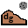

# Geodesic Profiler Tool 

This tool plots profile lines from raster layers or point vector layer with elevation field. 
Supports multiple lines as well as graph export to svg, pdf, png or csv file. 
Supports 3D polyline export to dxf. 
Horizontal profile distances are measured geodesically in meters using each
profile layer's CRS and the project's ellipsoid (or the CRS ellipsoid when the
project does not specify one).

## Geodesic distance calculations

Traditional planar measurement calculates line length directly from its
coordinates in the map projection. This is straightforward, but it measures
projected map units, which can differ from distances over a planetary body's
surface because projections distort scale. In a geographic CRS, planar length
is in degrees rather than meters, so it is not a useful surface-distance value.

Geodesic measurement instead measures each line segment along the surface of an
ellipsoid and sums the segment distances. This supports Earth and other
planetary bodies when their ellipsoid is configured in QGIS. The plugin uses
QGIS `QgsDistanceArea` with the project's configured ellipsoid, falling back to
the CRS ellipsoid when the project has no ellipsoid configured. Profile
distances are measured in the CRS used to sample each layer, and reported in
meters. The read-only distance indicators compare the drawn line's geodesic
length with its planar map-coordinate length; planar units are converted to
meters where possible. For an unprojected/geographic CRS, the planar readout
shows **Not applicable** because its coordinate length would be in degrees and
could be misleading; no distance is displayed in degrees. In that case, only
the geodesic length is reported. The values use extra decimal precision to make
small differences visible; they can still be equal when projection distortion
is negligible at the displayed precision.

## Installation

Download `geodesic_profiletool_0.9.0.zip` from the GitHub release and install it
in QGIS using **Plugins > Manage and Install Plugins > Install from ZIP**.

## Releases

Pushing a version tag such as `v0.9.0` creates a GitHub Release with a
QGIS-installable `geodesic_profiletool_0.9.0.zip` asset. The tag version must
match the plugin version in `metadata.txt`.

Authors: CoPilot GPT-6 Luna - (Original authors: Borys Jurgiel - Patrice Verchere - Etienne Tourigny - Javier Becerra)

**geodesic_profiletool license:**

    This program is free software: you can redistribute it and/or modify
    it under the terms of the GNU General Public License as published by
    the Free Software Foundation, either version 2 of the License, or
    (at your option) any later version.

    This program is distributed in the hope that it will be useful,
    but WITHOUT ANY WARRANTY; without even the implied warranty of
    MERCHANTABILITY or FITNESS FOR A PARTICULAR PURPOSE.  See the
    GNU General Public License for more details.

    You should have received a copy of the GNU General Public License
    along with this program.  If not, see <https://www.gnu.org/licenses/>.
